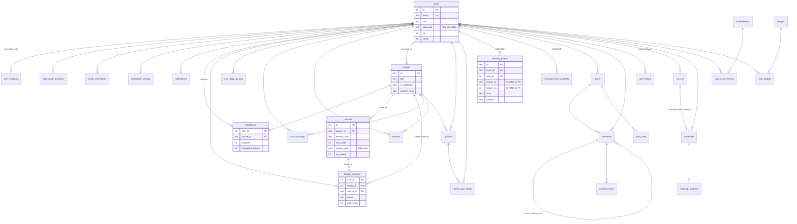

# ERD và đánh giá cơ sở dữ liệu (Neon `neondb`, đo 04/11/2026)

Chỉ ĐỌC: mọi truy vấn chạy trong `BEGIN READ ONLY … ROLLBACK`, không ghi gì vào DB.
Số liệu là ảnh chụp tại thời điểm đo; DB có người đang dùng nên sẽ lệch dần.

## 1. Hiện trạng

| Mục | Giá trị |
|---|---|
| Host | `ep-icy-math-aondnqer-pooler…ap-southeast-1` (Neon, Singapore) — **DB THẬT**: bản deploy của nhánh `main` đang dùng đúng DB này (Nhân xác nhận 04/11/2026) |
| Migration trong DB | 6: `0_init`, `…auth_session_family`, `…critical_indexes_and_lesson_sort_unique`, `…learning_events`, `…quizzes_kind_post_test`, `…learning_event_consents` |
| Migration trong nhánh `test` | 3 (ba cái đầu). **DB đi trước nhánh `test` 3 migration** — ba cái sau thuộc nhánh `main` |
| Bảng | 28 bảng nghiệp vụ + `_prisma_migrations`; 43 khoá ngoại; 31 khoá chính |
| Dữ liệu | `lessons` 245 dòng, `users` 103, `enrollments` 84, `learning_events` 163, `lesson_progress` 58, `auth_sessions` 44, `user_daily_xp_logs` 26, `quizzes` 2; **17 bảng rỗng** (cộng đồng, bảng khảo sát, lộ trình, huy hiệu…) |

Khoá học trong DB:

| `courses.id` | Tiêu đề | Số bài |
|---|---|---|
| `db_design` | Thiết kế CSDL… | 20 |
| `db_design_nc` | Bên trong Database Engine… | 25 |
| `db_design_tc` | SQL nâng cao… | 21 |
| `python_advanced` | **Python cho Data Analyst** | **179** (mã `CT01`…`VZ30`) |

**Phát hiện lớn nhất:** DB đang chứa giáo trình của nhánh `main` (khoá 179 bài Data Analyst), còn code nhánh `test` đọc khoá `python_advanced` 48 bài Advanced Python. Hai nhánh dùng chung `courses.id = python_advanced` nhưng nội dung khác hẳn. Chạy nhánh `test` vào DB này sẽ hiện nội dung của `main`, và `curricula.json` của `test` (48 bài) không khớp 179 bài trong DB.

## 2. ERD

Nhóm theo miền. Mọi bảng nối `users`; đường nét liền là khoá ngoại có thật.

Ba điểm ERD này nói thẳng:
- `learning_events.course_id` và `lesson_no` là chuỗi/số rời, **không** khoá ngoại tới `courses`/`lessons`. Bài đổi hoặc xoá thì sự kiện cũ vẫn trỏ về bài không còn.
- Giáo trình nằm trọn trong một cột JSON `lessons.content_json`; DB không biết "màn", "câu hỏi" hay "ca chấm" là gì.
- `lesson_progress.course_id` lặp lại thông tin đã suy ra được từ `lesson_id`.

## 3. Sức khoẻ dữ liệu (đã kiểm, không phải suy đoán)

| Kiểm tra | Kết quả |
|---|---|
| Bài trùng `(course_id, sort_order)` | 0, có unique index `uq_lessons_course_sort` |
| `lesson_code` NULL | 0 ở cả 4 khoá |
| `lesson_progress` mồ côi (bài hoặc user không còn) | 0 |
| Có tiến độ mà chưa ghi danh | 0 |
| Phiên (`auth_sessions`) đã hết hạn | 0 / 44 |
| Tiêu đề lỗi mã hoá (mojibake) | 0 |
| Chỉ mục trùng lặp | không có |

## 4. Vấn đề và đề xuất cải tiến

Xếp theo mức ảnh hưởng. **Chưa làm gì**; mỗi mục cần bạn duyệt, và migration chỉ được THÊM (ràng buộc trong AGENTS.md).

### P0 — lệch giữa DB và nhánh `test`
1. **DB đi trước `test` 3 migration và chứa khoá 179 bài.** Quyết định cần có: nhánh `test` sẽ dùng DB này, hay một DB/branch Neon riêng? Đề xuất: tạo *branch Neon* từ DB này cho `test` (tức thời, không tốn dữ liệu), để hai nhánh code không dẫm lên nhau. Không nạp 48 bài vào DB hiện tại vì sẽ `deleteMany` 179 bài và tiến độ.

### P1 — sửa được, rủi ro thấp
2. **22 khoá ngoại chưa có chỉ mục** (Postgres không tự tạo), đáng chú ý: `lesson_progress.lesson_id`, `lesson_progress.course_id`, `enrollments.course_id`, `quizzes.course_id`, `auth_sessions.user_id`, `posts/comments.user_id`. Ảnh hưởng thật: `auth_sessions` đã quét tuần tự 593 lần so với 11 lần dùng chỉ mục; `users` 2058 lần quét tuần tự. Bảng còn nhỏ nên chưa đau, nhưng xoá user hay xoá bài sẽ phải quét cả bảng con. Đề xuất: một migration `CREATE INDEX CONCURRENTLY IF NOT EXISTS` cho các cột này (chỉ thêm).
3. **`learning_events` thiếu liên kết tới `courses`/`lessons`.** Thêm FK nullable hoặc chỉ mục `(course_id, lesson_no)` (đã có `idx_learning_events_kind_lesson`) là đủ; FK cứng chỉ nên thêm khi chấp nhận xoá sự kiện theo bài.
4. **`lesson_progress.course_id` thừa.** Có thể lệch với `lessons.course_id` mà DB không bắt được. Đề xuất: thêm CHECK/trigger, hoặc ghi chú để code luôn lấy từ bài. Không xoá cột (ràng buộc dùng chung với Django).

### P2 — theo dõi
5. **Rác khách:** 98/103 tài khoản là `@guest.local`, trong đó 77 chưa học bài nào (dùng `NOT EXISTS lesson_progress`); chỉ 5 là tài khoản thật (vai trò `instructor`). Đề xuất: job dọn khách bất hoạt quá N ngày (cần chốt N; đây là xoá dữ liệu nên phải duyệt riêng). `user_daily_xp_logs`, `learning_events` cascade nên dọn user là dọn luôn.
6. **63/84 ghi danh có `completed_lessons = 0`** — phản ánh khách chỉ mở rồi bỏ; kết hợp mục 5.
7. **`lessons` nặng:** bảng 5,3 MB dù nội dung nén chỉ ~0,7 MB — phần lớn là chỉ mục GIN `lessons_content_json_idx` trên `content_json`. Nếu không có truy vấn nào dùng `@>`/`?` trên cột này (cần grep code) thì có thể bỏ chỉ mục đó. Chưa kiểm, nên chưa kết luận.
8. **17 bảng rỗng** (cộng đồng, khảo sát, lộ trình, huy hiệu…): là di sản của bản Django. Không xoá (DB dùng chung), nhưng nên ghi rõ bảng nào còn dùng.
9. **`DIRECT_URL` đã đổi sang host trực tiếp** (bỏ `-pooler`) ngày 04/11/2026; `prisma migrate status` chạy được qua host này (3 migration của `test` đều đã áp). Đây là DB thật nên mọi thay đổi (migration, nạp bài, dọn khách) phải duyệt riêng và có sao lưu trước.

## 5. Chưa kiểm
- Chưa đối chiếu từng bài với gói `scripts/pe-da` (đó là việc của nhánh `main`).
- Chưa đo độ chậm truy vấn thật (chỉ có số lần quét tuần tự).
- Chưa grep code xem chỉ mục GIN có được dùng không.
