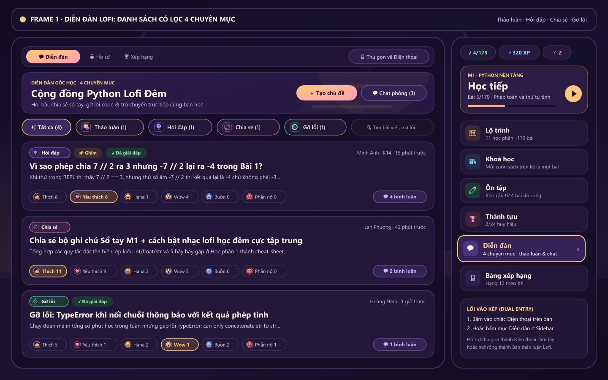
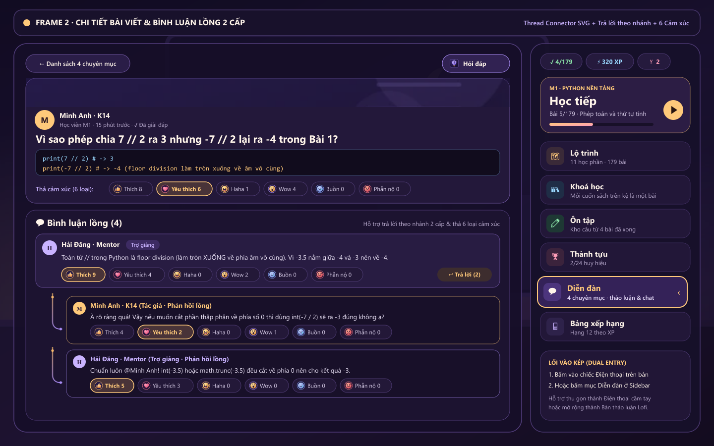
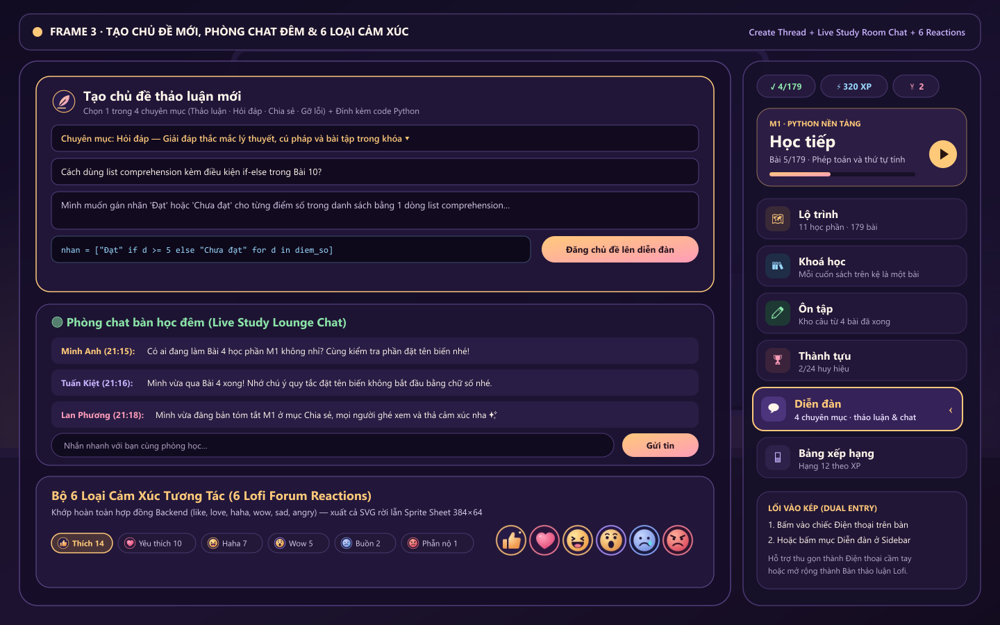
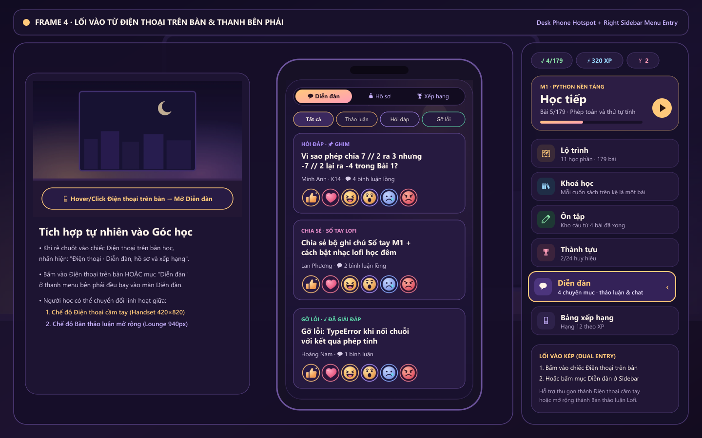
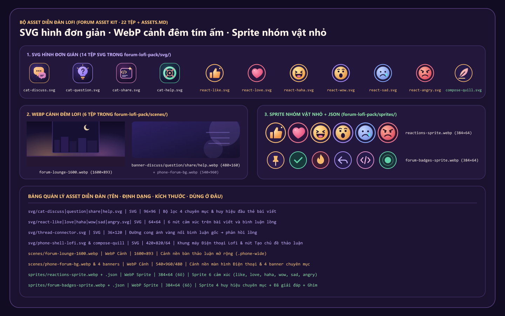

# Thiết Kế & Bộ Asset Diễn Đàn Thảo Luận Lofi (Góc Học · Điện Thoại & Thanh Bên Phải)

Tài liệu đặc tả thiết kế giao diện (Figma Frames), luồng tương tác và bảng quản lý tài nguyên (Assets) cho **Diễn đàn thảo luận Lofi (Lofi Discussion Platform)** của nền tảng học lập trình Python **PE Góc học**.

---

## 1. Triết lý thiết kế & Lối vào kép (Dual Entry Points)

Diễn đàn tuân thủ xuyên suốt ngôn ngữ thiết kế **Dark-Purple Lofi (`#120c22` → `#1e1434`, điểm nhấn vàng đèn bàn `#ffc97a`, tím lilac `#c9b3ff` và hồng sakura `#ff9db8`)** của căn phòng **Góc học**:

1. **Lối vào 1 — Chiếc Điện thoại trên bàn học (`#phone` hotspot trong `engine.js`)**:
   - Khi người học rê chuột vào chiếc điện thoại trên mặt bàn gỗ, nhãn nổi hiển thị: **`Điện thoại · Diễn đàn, hồ sơ và xếp hạng`**.
   - Bấm vào chiếc điện thoại sẽ kích hoạt hoạt ảnh nhấc máy lên (`pickStart('phone')` / `flyInto`) và mở ngay tab **`💬 Diễn đàn`**.
2. **Lối vào 2 — Mục `Diễn đàn` trên Thanh menu bên phải (`#side` trong `shell.js`)**:
   - Nằm ngay trên thanh điều hướng bên phải cạnh *Lộ trình, Khoá học, Ôn tập, Thành tựu, Bảng xếp hạng*.
   - Hiển thị số lượng chuyên mục và tổng số chủ đề đang thảo luận (`4 chuyên mục · thảo luận`).
3. **Hai chế độ khung nhìn linh hoạt**:
   - **Chế độ Bàn thảo luận mở rộng (`.phone-wide`, rộng `940px`)**: Không gian đọc bài, xem mã Python, trả lời bình luận lồng và chat trực tiếp thoải mái như một diễn đàn đầy đủ.
   - **Chế độ Điện thoại cầm tay (`Handset mode`, `420×820`)**: Giữ nguyên cảm giác cầm chiếc điện thoại lofi trên bàn học.

---

## 2. Năm Frame Figma & Tính năng cốt lõi

### Frame 1 · Danh sách bài viết có lọc 4 chuyên mục (`forum-frame-1-feed-4-categories.png`)
- **4 chuyên mục khớp 100% hợp đồng Backend (`src/forum/dto/forum.dto.ts`)**:
  1. `discuss` — **Thảo luận** (`#f6b86b`, icon `cat-discuss.svg`, banner `banner-discuss.webp`)
  2. `question` — **Hỏi đáp** (`#a98cf5`, icon `cat-question.svg`, banner `banner-question.webp`)
  3. `share` — **Chia sẻ** (`#e58cc8`, icon `cat-share.svg`, banner `banner-share.webp`)
  4. `help` — **Gỡ lỗi** (`#5cd6a9`, icon `cat-help.svg`, banner `banner-help.webp`)
- Hỗ trợ lọc theo từng chuyên mục, tìm kiếm theo từ khóa/mã lỗi, và sắp xếp theo **Mới nhất** hoặc **Nhiều cảm xúc**.

### Frame 2 · Chi tiết bài viết & Bình luận lồng 2 cấp (`forum-frame-2-post-detail-nested-comments.png`)
- Hiển thị đầy đủ nội dung câu hỏi/chia sẻ, tác giả, vai trò, nhãn **Đã giải đáp (`✓ Đã giải đáp`)**, khối mã nguồn Python (`.lf-code-block`) và thanh 6 loại cảm xúc.
- **Bình luận lồng 2 cấp (`parentCommentId` / `replies`)**:
  - Bình luận gốc (`.lf-cmt-card`) hỗ trợ bấm **`↩ Trả lời`** để mở ô nhập phản hồi ngay bên dưới.
  - Các phản hồi lồng (`.lf-cmt-nested`) được nối với bình luận gốc bằng đường cong ánh vàng **`thread-connector.svg`**.

### Frame 3 · Tạo chủ đề thảo luận, Phòng chat đêm & 6 loại cảm xúc (`forum-frame-3-six-reactions-composer.png`)
- **Tạo chủ đề mới (`＋ Tạo chủ đề`)**: Cho phép học viên chọn 1 trong 4 chuyên mục, nhập tiêu đề, nội dung và đính kèm đoạn mã Python.
- **Phòng chat bàn học đêm (`💬 Chat phòng học`)**: Khung trò chuyện nhanh theo thời gian thực để học viên hỏi đáp ngắn khi đang thức học khuya.
- **6 loại cảm xúc tương tác (`like`, `love`, `haha`, `wow`, `sad`, `angry`)**: Hoạt động trên cả bài viết lẫn từng bình luận gốc và bình luận trả lời lồng.

### Frame 4 · Lối vào từ Điện thoại trên bàn & Thanh bên phải (`forum-frame-4-phone-sidebar-entry.png`)
- Minh họa sự kết nối liền mạch giữa vật thể **Điện thoại** trên bàn học, mục **Diễn đàn** trên thanh bên phải, và giao diện **Handset Mode**.

### Frame 5 · Bộ Asset & Bảng Asset (`forum-asset-sheet-preview.png`)
- Tổng hợp trực quan toàn bộ 14 tệp SVG, 6 tệp WebP cảnh đêm và 2 tệp Sprite Sheet kèm bảng tra cứu.

---

## 3. Bảng Quản Lý Asset Diễn Đàn (Tên · Định dạng · Kích thước · Dùng ở đâu)

Toàn bộ asset đã được xuất vào:
- `forum-lofi-pack/` (thư mục độc lập ở gốc workspace)
- `pe-usth-main/frontend/public/forum-lofi/` (thư mục phục vụ trực tiếp cho ứng dụng Next.js)

| STT | Tên tệp (Đường dẫn tương đối) | Định dạng | Kích thước | Dung lượng | Dùng ở đâu |
| :-: | :--- | :--- | :---: | :---: | :--- |
| 1 | `svg/cat-discuss.svg` | SVG (hình đơn giản) | `96×96` | 1.1 KB | Icon chuyên mục **Thảo luận** trên thanh lọc 4 chuyên mục & chip đầu thẻ bài |
| 2 | `svg/cat-question.svg` | SVG (hình đơn giản) | `96×96` | 1.0 KB | Icon chuyên mục **Hỏi đáp** trên thanh lọc 4 chuyên mục & chip đầu thẻ bài |
| 3 | `svg/cat-share.svg` | SVG (hình đơn giản) | `96×96` | 1.0 KB | Icon chuyên mục **Chia sẻ** trên thanh lọc 4 chuyên mục & chip đầu thẻ bài |
| 4 | `svg/cat-help.svg` | SVG (hình đơn giản) | `96×96` | 1.1 KB | Icon chuyên mục **Gỡ lỗi** trên thanh lọc 4 chuyên mục & chip đầu thẻ bài |
| 5 | `svg/react-like.svg` | SVG (hình đơn giản) | `64×64` | 0.9 KB | Biểu tượng cảm xúc **Thích (`like`)** trong thanh 6 cảm xúc bài viết & bình luận |
| 6 | `svg/react-love.svg` | SVG (hình đơn giản) | `64×64` | 0.8 KB | Biểu tượng cảm xúc **Yêu thích (`love`)** trong thanh 6 cảm xúc bài viết & bình luận |
| 7 | `svg/react-haha.svg` | SVG (hình đơn giản) | `64×64` | 1.0 KB | Biểu tượng cảm xúc **Haha (`haha`)** trong thanh 6 cảm xúc bài viết & bình luận |
| 8 | `svg/react-wow.svg` | SVG (hình đơn giản) | `64×64` | 0.9 KB | Biểu tượng cảm xúc **Wow (`wow`)** trong thanh 6 cảm xúc bài viết & bình luận |
| 9 | `svg/react-sad.svg` | SVG (hình đơn giản) | `64×64` | 1.0 KB | Biểu tượng cảm xúc **Buồn (`sad`)** trong thanh 6 cảm xúc bài viết & bình luận |
| 10 | `svg/react-angry.svg` | SVG (hình đơn giản) | `64×64` | 1.0 KB | Biểu tượng cảm xúc **Phẫn nộ (`angry`)** trong thanh 6 cảm xúc bài viết & bình luận |
| 11 | `svg/phone-shell-lofi.svg` | SVG (hình đơn giản) | `420×820` | 1.4 KB | Khung viền chiếc Điện thoại Lofi tím đêm khi ở chế độ thu gọn |
| 12 | `svg/thread-connector.svg` | SVG (hình đơn giản) | `36×120` | 0.7 KB | Đường nhánh cong ánh vàng nối từ bình luận gốc xuống các bình luận trả lời lồng |
| 13 | `svg/compose-quill.svg` | SVG (hình đơn giản) | `64×64` | 0.8 KB | Icon cây bút lông lofi ở tiêu đề khung **Tạo chủ đề thảo luận mới** |
| 14 | `svg/empty-forum.svg` | SVG (hình đơn giản) | `180×140` | 1.1 KB | Minh họa trạng thái trống khi bộ lọc hoặc từ khóa tìm kiếm chưa có bài khớp |
| 15 | `scenes/forum-lounge-1600.webp` | WebP (cảnh nền) | `1600×893` | 29.8 KB | Cảnh nền phòng thảo luận đêm tím ấm khi mở rộng bàn thảo luận (`.phone-wide`) |
| 16 | `scenes/phone-forum-bg.webp` | WebP (cảnh nền) | `540×960` | 14.2 KB | Cảnh nền dọc bên trong màn hình chiếc Điện thoại (`#phone .scr`) |
| 17 | `scenes/banner-discuss.webp` | WebP (cảnh banner) | `480×160` | 4.9 KB | Banner đầu danh sách và đầu trang chi tiết của chuyên mục **Thảo luận** |
| 18 | `scenes/banner-question.webp` | WebP (cảnh banner) | `480×160` | 5.2 KB | Banner đầu danh sách và đầu trang chi tiết của chuyên mục **Hỏi đáp** |
| 19 | `scenes/banner-share.webp` | WebP (cảnh banner) | `480×160` | 5.1 KB | Banner đầu danh sách và đầu trang chi tiết của chuyên mục **Chia sẻ** |
| 20 | `scenes/banner-help.webp` | WebP (cảnh banner) | `480×160` | 5.4 KB | Banner đầu danh sách và đầu trang chi tiết của chuyên mục **Gỡ lỗi** |
| 21 | `sprites/reactions-sprite.webp` + `.json` | WebP Sprite + JSON | `384×64` (6 ô `64×64`) | 9.6 KB | Sprite sheet gộp 6 cảm xúc (`like, love, haha, wow, sad, angry`) |
| 22 | `sprites/forum-badges-sprite.webp` + `.json` | WebP Sprite + JSON | `384×64` (6 ô `64×64`) | 8.4 KB | Sprite sheet gộp 4 huy hiệu chuyên mục + nhãn Đã giải đáp + nhãn Ghim |
