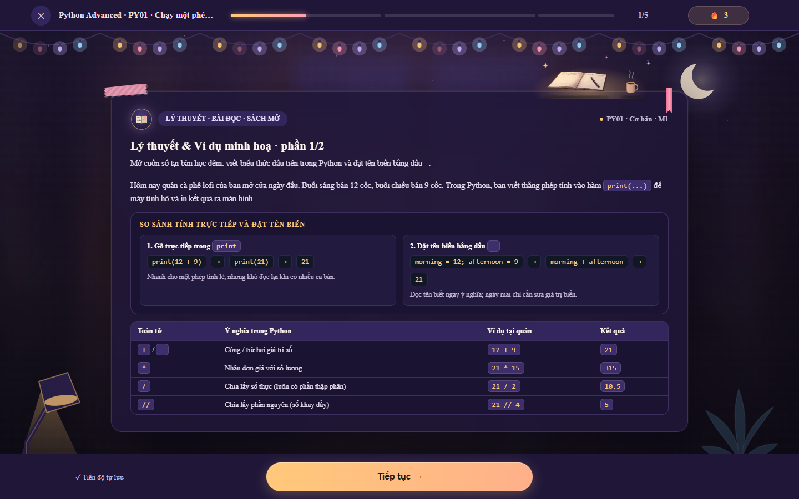
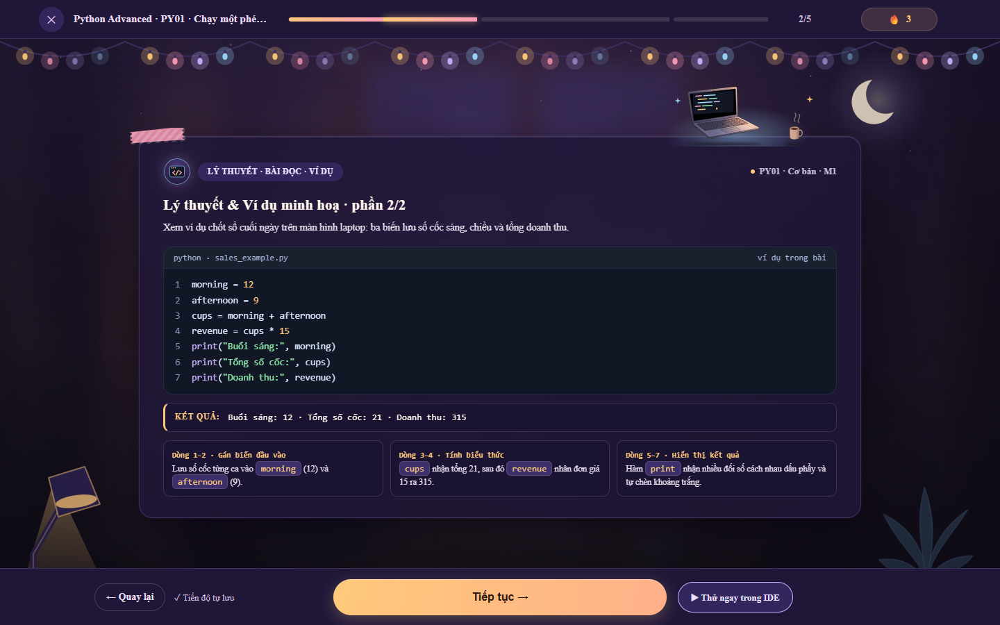
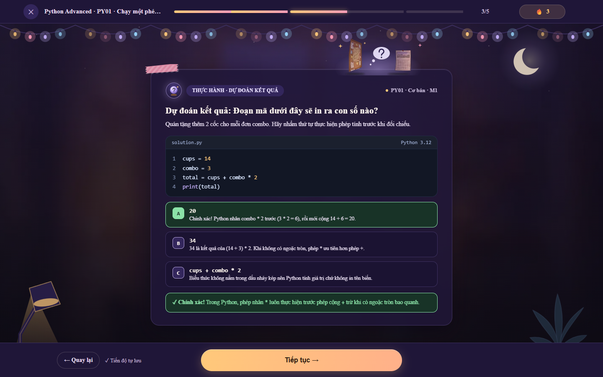
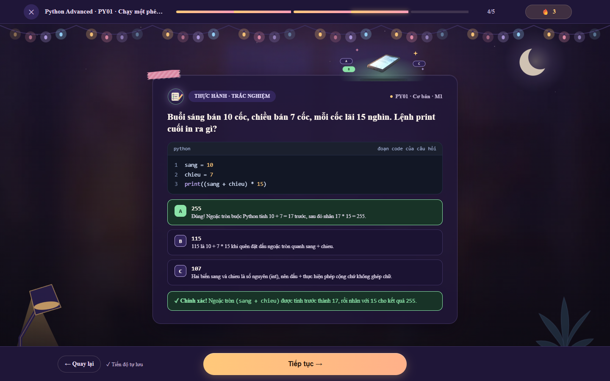
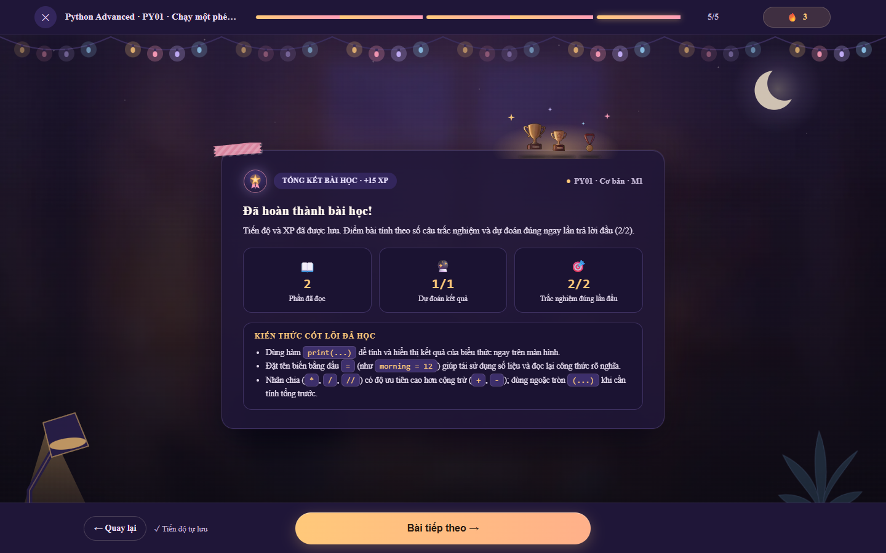
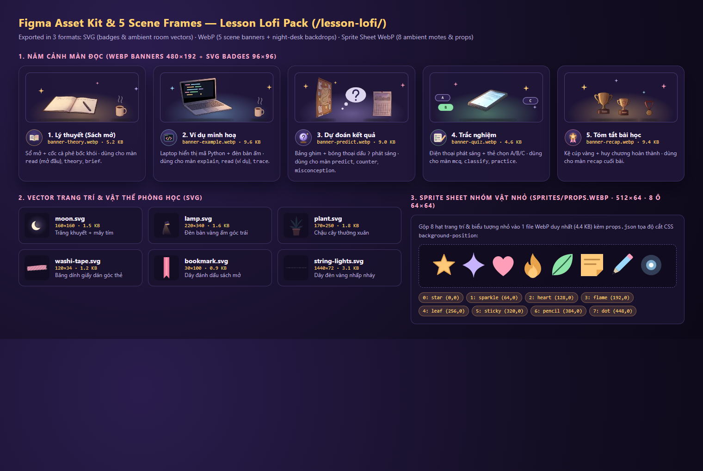

# Thiết kế Lofi & Bộ Asset cho Màn Đọc Bài Học (Lesson Reader)

Tài liệu này tổng hợp toàn bộ thiết kế giao diện **Lofi Dark-Purple**, bộ khung Figma (5 màn đọc), bảng quản lý asset (`SVG`, `WebP`, `Sprite`), và danh sách các file mã nguồn đã được cập nhật.

> **Mẹo xem nhanh**: Bạn có thể mở trực tiếp file [`lofi-lesson-preview.html`](./lofi-lesson-preview.html) trên trình duyệt để tương tác thử ngay cả 5 màn học (*Lý thuyết sách mở → Ví dụ → Dự đoán kết quả → Trắc nghiệm → Tóm tắt*) và xem bảng Asset trực quan mà không cần bật server.

---

## 1. Hình ảnh kết xuất 5 Màn Học (Figma Frames `1440×900`)

### Màn 1 — Lý thuyết (Sách mở) · `scene="theory"`

### Màn 2 — Ví dụ minh họa · `scene="example"`

### Màn 3 — Dự đoán kết quả · `scene="predict"`

### Màn 4 — Trắc nghiệm · `scene="quiz"`

### Màn 5 — Tóm tắt bài học · `scene="recap"`

### Bảng tổng hợp Asset Kit (`SVG` · `WebP` · `Sprite`)

---

## 2. Thông số Frame Figma & Hệ màu Lofi Dark-Purple

| Thuộc tính | Giá trị thiết kế |
| :--- | :--- |
| **Kích thước Frame Desktop** | `1440 × 900 px` (Safe reading container: `max-width: 760px`, bo góc `20px`) |
| **Kích thước Frame Mobile** | `720 × 1280 px` (Tự động đổi sang `night-desk-720.webp` qua `<picture>`) |
| **Nền đêm tím trầm (`--lf-bg-deep` → `--lf-bg-dusk`)** | `#120d24` → `#1b1435` → `#271c4a` |
| **Mặt thẻ bài học (`--edu-panel-bg`)** | `rgba(31, 23, 56, 0.84)` kèm `backdrop-filter: blur(18px)` |
| **Viền thẻ & khung sách (`--edu-card-line`)** | `rgba(255, 226, 184, 0.16)` (viền kem ấm) + viền sáng trên `rgba(255, 240, 210, 0.12)` |
| **Điểm nhấn đèn bàn & CTA (`--lf-amber`)** | `#f6b86b` → `#e88c5d` (vàng cam ấm giống nút Play ở Góc học) |
| **Điểm nhấn tím hoa anh đào (`--lf-sakura`)** | `#e58cc8` / `#a98cf5` |
| **Chữ chính / phụ (`--lf-ink` / `--lf-ink-soft`)** | `#f7f2ff` / `#cfc3e8` |

---

## 3. Bảng Asset (Tên, Định dạng, Kích thước, Nơi dùng)

Toàn bộ asset đã được xuất vào:
- Thư mục gói thiết kế: `./lofi-lesson-pack/`
- Thư mục public của Frontend: `./pe-usth-main/frontend/public/lesson-lofi/`

| Tên file | Định dạng | Kích thước (px) | Dung lượng | Dùng ở đâu |
| :--- | :--- | :--- | :--- | :--- |
| `svg/badge-theory.svg` | SVG | `96 × 96` | 1.0 KB | Huy hiệu góc trái header màn **Lý thuyết (sách mở)** (`ShellB` `scene="theory"`) |
| `svg/badge-example.svg` | SVG | `96 × 96` | 0.9 KB | Huy hiệu góc trái header màn **Ví dụ** (`ShellB` `scene="example"`) |
| `svg/badge-predict.svg` | SVG | `96 × 96` | 1.2 KB | Huy hiệu góc trái header màn **Dự đoán kết quả** (`ShellB` `scene="predict"`) |
| `svg/badge-quiz.svg` | SVG | `96 × 96` | 1.4 KB | Huy hiệu góc trái header màn **Trắc nghiệm** (`ShellB` `scene="quiz"`) |
| `svg/badge-recap.svg` | SVG | `96 × 96` | 1.0 KB | Huy hiệu góc trái header màn **Tóm tắt** (`Recap` & `ShellB` `scene="recap"`) |
| `svg/moon.svg` | SVG | `160 × 160` | 0.6 KB | Mặt trăng lưỡi liềm và mây tím trên nền trời (`LofiBackdrop.tsx`) |
| `svg/string-lights.svg` | SVG | `1440 × 72` | 8.3 KB | Dây đèn vàng ấm nhấp nháy dọc thanh tiến độ trên cùng (`LofiBackdrop.tsx`) |
| `svg/lamp.svg` | SVG | `220 × 340` | 0.9 KB | Đèn bàn học tỏa quầng sáng ấm góc dưới bên trái (`LofiBackdrop.tsx`) |
| `svg/plant.svg` | SVG | `170 × 250` | 0.6 KB | Chậu cây dây leo đung đưa nhẹ góc dưới bên phải (`LofiBackdrop.tsx`) |
| `svg/washi-tape.svg` | SVG | `120 × 34` | 0.5 KB | Băng dính giấy washi dán góc trên thẻ bài học (`ShellB.tsx`) |
| `svg/bookmark.svg` | SVG | `30 × 100` | 0.4 KB | Dải ruy-băng đánh dấu sách đung đưa ở màn **Lý thuyết (sách mở)** (`ShellB.tsx`) |
| `scenes/night-desk-1600.webp` | WebP | `1600 × 893` | 7.7 KB | Cảnh nền phòng học lofi ban đêm cho màn hình ngang (`LofiBackdrop.tsx`) |
| `scenes/night-desk-720.webp` | WebP | `720 × 1280` | 5.1 KB | Cảnh nền phòng học lofi ban đêm cho màn hình dọc/mobile (`LofiBackdrop.tsx`) |
| `scenes/banner-theory.webp` | WebP | `480 × 192` | 15.6 KB | Cảnh minh họa sách mở có hào quang ấm ở mép trên thẻ **Lý thuyết** |
| `scenes/banner-example.webp` | WebP | `480 × 192` | 19.9 KB | Cảnh minh họa laptop & cửa sổ code cho thẻ **Ví dụ** |
| `scenes/banner-predict.webp` | WebP | `480 × 192` | 17.0 KB | Cảnh minh họa quả cầu pha lê `>>> ?` cho thẻ **Dự đoán kết quả** |
| `scenes/banner-quiz.webp` | WebP | `480 × 192` | 16.7 KB | Cảnh minh họa 4 thẻ lựa chọn A/B/C/D cho thẻ **Trắc nghiệm** |
| `scenes/banner-recap.webp` | WebP | `480 × 192` | 17.6 KB | Cảnh minh họa cúp vàng & sao hoàn thành cho thẻ **Tóm tắt** |
| `sprites/props.webp` + `props.json` | Sprite WebP + JSON | `512 × 64` (8 ô `64×64`) | 6.1 KB | Nhóm 8 vật nhỏ (`star`, `sparkle`, `heart`, `flame`, `leaf`, `sticky`, `pencil`, `dot`) dùng cho hạt sáng bay lên & icon nhỏ |

---

## 4. Danh sách các file mã nguồn đã thêm / cập nhật trong `pe-usth-main/`

1. `pe-usth-main/scripts/build-lesson-assets.mjs` — Script sinh toàn bộ bộ asset `SVG`, `WebP`, `sprites/props.webp` và bảng `ASSETS.md`.
2. `pe-usth-main/frontend/public/lesson-lofi/` — Thư mục chứa 20 file asset và `ASSETS.md`.
3. `pe-usth-main/frontend/src/components/lesson-chrome/lofi-theme.css` — Hệ biến CSS màu tối tím lofi (`--lf-*`, `--ds-*`, `--st-*`, `--edu-*`) và animation chuyển động nhẹ.
4. `pe-usth-main/frontend/src/components/lesson-chrome/LofiBackdrop.tsx` — Lớp cảnh nền lofi động (cảnh đêm, sao lấp lánh, hạt bụi sáng từ sprite, dây đèn, đèn bàn, chậu cây).
5. `pe-usth-main/frontend/src/components/lesson-chrome/LessonChrome.tsx` & `LessonChrome.module.css` — Gắn `data-lofi` và `<LofiBackdrop />` vào khung bài học, đồng bộ thanh tiến độ và nút CTA vàng cam ấm.
6. `pe-usth-main/frontend/src/components/lesson-chrome/ShellB.tsx` & `ShellB.module.css` — Thêm prop `scene` (`'theory' | 'example' | 'predict' | 'quiz' | 'recap'`), hiển thị banner WebP, huy hiệu SVG, băng dính washi và dây kẹp sách.
7. `pe-usth-main/frontend/src/components/lesson-chrome/exercises/Recap.tsx` & `Recap.module.css` — Thiết kế lại màn **Tóm tắt** với thẻ kính tím đậm, banner cúp vàng và huy hiệu tổng kết.
8. `pe-usth-main/frontend/src/components/python-studio/screens/chrome.tsx` — Tự động ánh xạ từng bước học sang đúng `scene` (`theory`, `example`, `predict`, `quiz`, `recap`).
9. `pe-usth-main/frontend/src/lib/lesson-load.ts`, `useLessonData.ts`, `StudioLesson.tsx` — Bổ sung dữ liệu bài học 5 màn dự phòng (`baiHocDuPhong`) khi chạy riêng Frontend để bấm **"Mở bài 1"** vào thẳng bài học lofi thay vì màn trắng báo lỗi mạng.
